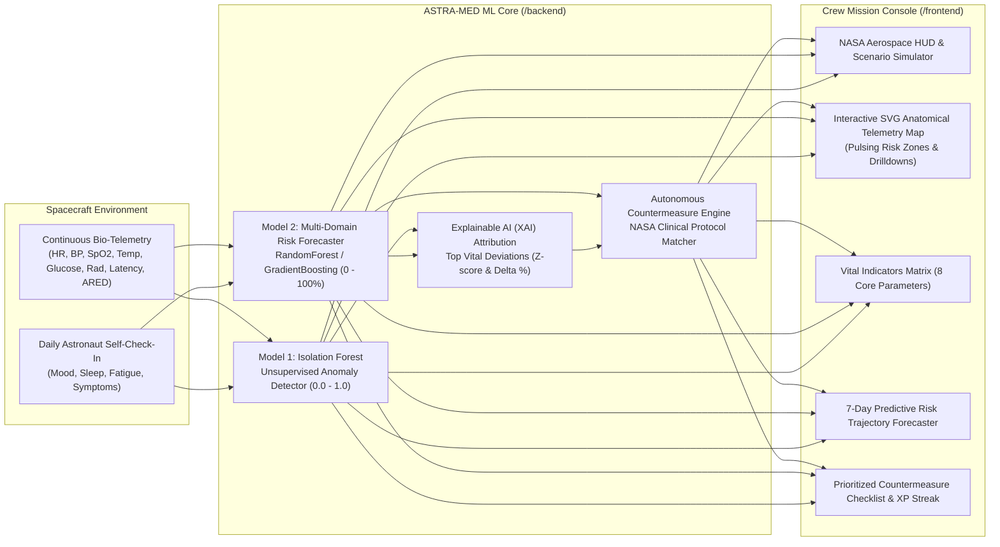

# ASTRA-MED: Autonomous Deep-Space Astronaut Health Monitoring & AI Flight Surgeon System
### NASA Space Apps Challenge 2026 — *"Create Health Monitoring Software for Astronauts on Space Missions"*

---

## 🚀 Mission Overview & Problem Alignment
During long-duration deep-space transit missions (e.g., Earth-to-Mars or Lunar Deep Space Gateway), round-trip communication delays with Earth reach up to **22 to 44 minutes**. Crew members cannot rely on real-time ground-based flight surgeons during physiological crises. 

**ASTRA-MED** is a zero-hardware-required, full-stack autonomous AI Flight Surgeon application built to monitor, evaluate, and provide actionable clinical countermeasures across the **4 core spaceflight risk domains** defined in the official NASA challenge brief:

1. **Cardiovascular Events:** Cephalad fluid shifts in microgravity, orthostatic intolerance upon repressurization/EVA egress, resting tachycardia, and baroreceptor desensitization.
2. **Immune Changes & Radiation Exposure:** High-energy Galactic Cosmic Rays (GCR) and Solar Particle Events (SPE), biological dosage tracking (mSv), core body temperature spikes ("space fever"), and cytokine inflammatory reactions.
3. **Bone Loss & Musculoskeletal Deconditioning:** Microgravity bone mineral density (BMD) decay rates, sarcomere atrophy, and daily Advanced Resistive Exercise Device (ARED) protocol compliance.
4. **Behavioral Health Problems:** Chronic isolation and confinement fatigue, circadian desynchrony, sleep architecture disruption, elevated psychomotor cognitive reaction latency, and psychological stress.

---

## 🧠 System Architecture



---

## 🔬 AI/ML Dual-Engine Specifications

### Model 1: Unsupervised Multi-Vital Anomaly Detection (`IsolationForest`)
- **Purpose:** Continuous screening of 13 cross-correlated bio-telemetric channels against calibrated microgravity baselines.
- **Output:** Anomaly Score from `0.00` (nominal microgravity adaptation) to `1.00` (severe multi-system anomaly).
- **Clinical Significance:** Catches subtle, multi-variable departures before they escalate into acute clinical emergencies.

### Model 2: Multi-Domain Risk Forecaster (`RandomForestRegressor` / `GradientBoosting`)
- **Purpose:** Predicts 7-day forward risk trajectories across each of the 4 NASA spaceflight health pillars:
  - `cardiovascular` (0–100%)
  - `immune_radiation` (0–100%)
  - `bone_musculoskeletal` (0–100%)
  - `behavioral_health` (0–100%)
- **Readiness Score:** Computes composite **Astronaut Mission Health Readiness (0–100%)**.

### Explainable AI (XAI) Feature Attribution
- Identifies the top physiological drivers triggering alerts with exact z-scores and percentage deltas relative to microgravity baselines (e.g., *"Elevated by +14% resting HR & -2.1h sleep debt"*).

### Autonomous Countermeasure Recommender
- Dynamically pairs multi-domain risk states with concrete NASA flight surgeon medical protocols:
  - *Acute Orthostatic Fluid-Loading Protocol (500mL isotonic fluid load + Class II compression garment)*
  - *Deep-Space Storm Shelter Relocation & Polyethylene Shielding Protocol*
  - *Intensive ARED Resistive Loading & Axial Compression (240 lbs eccentric squat)*
  - *Circadian Reset & Dynamic 480nm Spectrum Lighting Shift*

---

## 🎮 Gamified Crew Adherence & Engagement
Long-duration isolation causes behavioral disengagement. ASTRA-MED incorporates a **Mission Health Streak** counter and **Readiness XP** reward system:
- Logging daily self-check-ins awards **+50 XP**.
- Executing clinical countermeasure protocols awards **+100 to +200 XP**.
- Preserves long-term mission compliance and morale on 180+ day journeys.

---

## ⚙️ Project Structure

```
d:/ASTRA-MED/
├── backend/
│   ├── main.py                 # FastAPI REST and SSE live streaming server
│   ├── telemetry_engine.py     # 180-day NASA telemetry generator & 4 scenario presets
│   ├── ml_models.py            # Dual-model ML engine (Isolation Forest + Risk Forecaster)
│   ├── countermeasures.py      # NASA clinical countermeasure protocols
│   ├── test_engine.py          # Validation check script across all scenarios
│   └── requirements.txt        # Python backend dependencies
├── frontend/
│   ├── src/
│   │   ├── components/
│   │   │   ├── Header.tsx              # Scenario switcher, MET, streak, XP bar
│   │   │   ├── BodyMap.tsx             # Interactive SVG human body map with pulsing zones
│   │   │   ├── TelemetryMatrix.tsx     # 8 core vitals telemetry cards
│   │   │   ├── RiskTrajectoryPanel.tsx # 7-day trajectory chart (Recharts) & XAI badges
│   │   │   ├── CountermeasuresList.tsx # Actionable protocol queue with one-click execution
│   │   │   └── SelfCheckInModal.tsx    # Astronaut daily self-report drawer
│   │   ├── App.tsx                     # Main console layout and state orchestration
│   │   ├── main.tsx                    # React DOM entrypoint
│   │   ├── index.css                   # Tailwind styles, glassmorphism, and HUD grid
│   │   └── types.ts                    # TypeScript data models
│   ├── package.json
│   ├── vite.config.ts
│   └── tailwind.config.js
└── README.md
```

---

## 🛠️ Quickstart Guide

### 1. Backend Setup & Startup
```powershell
# Navigate to backend directory
cd backend

# Install dependencies
pip install -r requirements.txt

# Start FastAPI server on port 8000
python -m uvicorn main:app --host 127.0.0.1 --port 8000 --reload
```
API will be live at `http://127.0.0.1:8000` with Swagger documentation at `http://127.0.0.1:8000/docs`.

### 2. Frontend Mission Console Startup
```powershell
# Navigate to frontend directory
cd frontend

# Install dependencies
npm install

# Start Vite dev server on port 5173
npm run dev
```
Open `http://localhost:5173` in any modern web browser.

